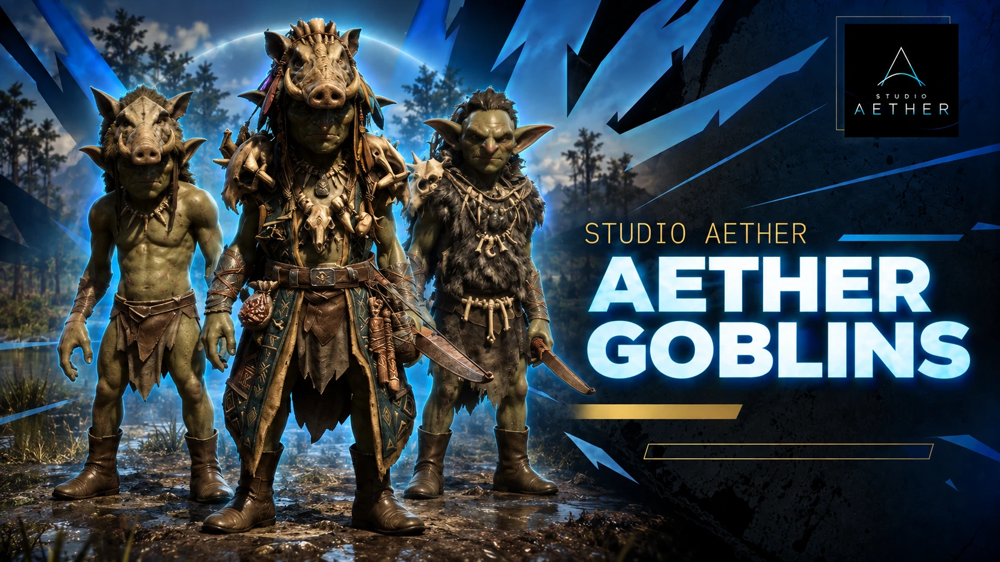

`aether_goblins` adds hostile goblins to your server. You place ambush points in the config,
and when a player walks into one the server rolls the dice. On a hit, goblins appear in a
ring around that player and attack. Staff can also open a spawn menu and put goblins in
front of them whenever they want one.

The goblins do not flee, and everyone nearby sees the same goblins.

## Features

- **Three goblin types** with their own look: the Boarhelm swings a machete, Grimfang and the Shaman use bows.
- **Ambush points** with radius, amount, type, hit chance in percent and cooldown.
- **Automatic despawn** for ambushes, plus limits per spawn, per player and in total.
- **Admin spawn menu**, guarded by ACE.
- **Position helper** that prints your coordinates as a ready `vec3` line for the config.
- **Exports** for your own scripts: 9 server, 4 client.
- **Seven languages**, all editable.
- **Standalone**, no framework needed.

## Quick facts

| | |
|---|---|
| Resource name | `aether_goblins` |
| Version | 1.1.1 |
| Game | RedM (`rdr3`) |
| Framework | none required |
| Database | none |
| Languages | `en`, `de`, `fr`, `pt`, `es`, `th`, `it` |
| Open after escrow | `config.lua`, `locales/*.lua`, `README.md` |

## Good to know

The first install needs a full server restart, a resource restart is not enough.
Grimfang and the Shaman have no face animation.

## Store

[Aether Goblins on the Studio Aether store](https://studio-aether.tebex.io/package/7720932)

## Pages

- [Configuration](/customer-docs/resources/aether-goblins/configuration/)
- [Commands and menu](/customer-docs/resources/aether-goblins/commands/)
- [Developer API](/customer-docs/resources/aether-goblins/developers/)
- [Troubleshooting](/customer-docs/resources/aether-goblins/troubleshooting/)
