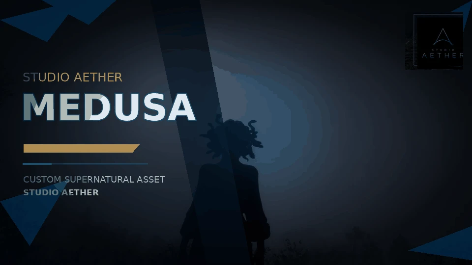

`aether_medusa` gives a player a crown of living snakes. Ten of them sway, turn their
heads and open their jaws, each on its own timing, and the two on top rise up in turn
and settle back down. Scales, belly and heads are coloured separately, and everyone
nearby sees the same look.

## Features

- **Ten moving snakes** with their own jaws. The motion is part of the model, the script stays out of the way.
- **Three colour zones**: scales, belly and heads, each with its own 32 colours, previewed live in the menu.
- **Female and male fit.**
- **Motion switch** in the menu, optionally on a key. The choice is saved with the look.
- **Menu with an orbit camera**, so you see the change while you make it.
- **Fine placement** for ped models that sit differently. Belly and heads follow the scales.
- **Presets**: an admin saves a look by name and it applies for everyone without a restart.
- **Saved looks**: players get theirs back on join and can switch that off.
- **Permissions** in five nodes. VORP and RSG groups are detected, or use ACE.
- **Exports** for your own scripts, server and client.
- **Seven languages**, all editable.

## Quick facts

| | |
|---|---|
| Resource name | `aether_medusa` |
| Version | 0.16.0 |
| Game | RedM (`rdr3`) |
| Framework | none required, VORP and RSG are detected |
| Database | `oxmysql`, only for saving looks |
| Languages | `en`, `de`, `fr`, `pt`, `es`, `th`, `it` |
| Open after escrow | `config.lua`, `data/presets.lua`, `locales/*.lua`, `README.md`, `docs/DEVELOPERS.md` |

## Good to know

Looks saved before 0.16 keep their colour on the scales.
Players need a fresh connect after the resource is added, streamed assets only load on join.

## Store

[Aether Medusa on the Studio Aether store](https://studio-aether.tebex.io/package/7716877)

## Requirements

- A RedM server (`rdr3`).
- No framework required, VORP and RSG are detected.
- `oxmysql` only for saving looks.

## Pages

- [Configuration](/customer-docs/resources/aether-medusa/configuration/)
- [Commands and menu](/customer-docs/resources/aether-medusa/commands/)
- [Developer API](/customer-docs/resources/aether-medusa/developers/)
- [Troubleshooting](/customer-docs/resources/aether-medusa/troubleshooting/)
